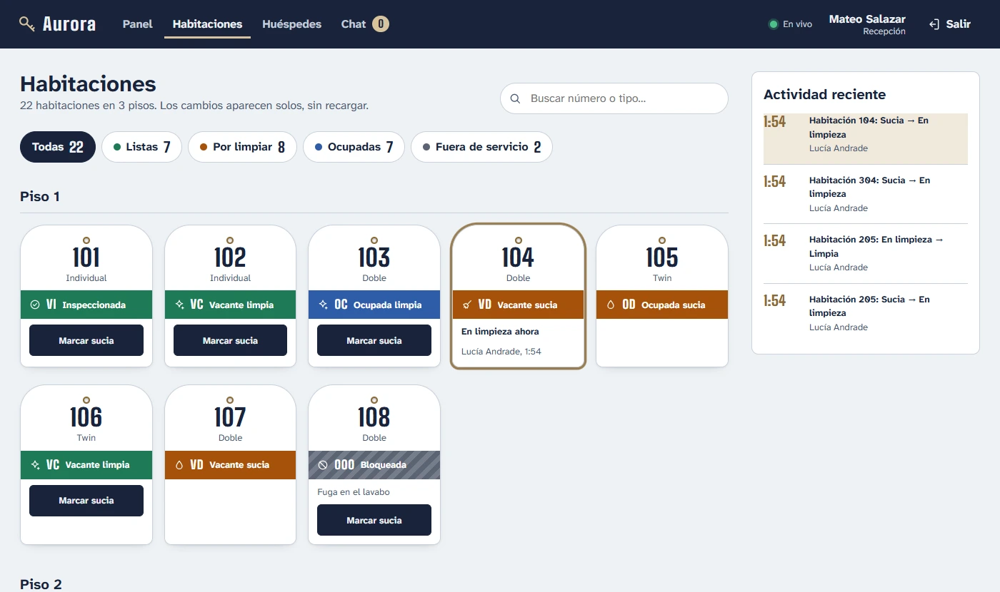
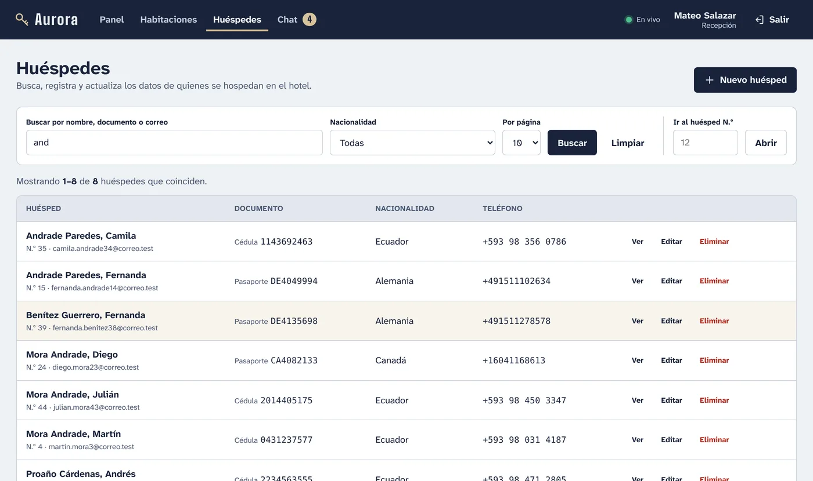
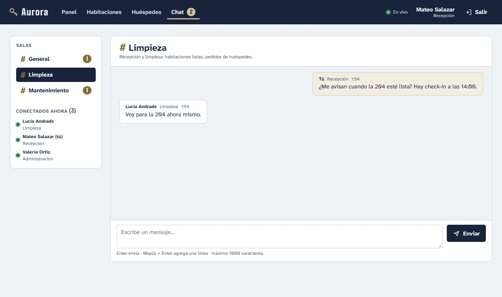
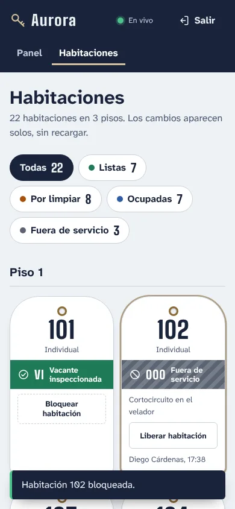

# Aurora PMS

[](https://github.com/a-sebs/PMS_PROJECT/actions/workflows/ci.yml)

Property Management System para un hotel boutique (PYME de hospitalidad), construido para la
asignatura **Aplicaciones Web Avanzadas**. Es una **aplicación monolítica** con el stack de la guía
del curso (Node.js + Express + EJS + HTML5/CSS3/JavaScript + Socket.IO): las vistas y las rutas se
resuelven en el servidor, y el WebSocket vive en el mismo proyecto.

> **Entrega del primer bimestre:** la [matriz de cumplimiento](docs/02-analisis/matriz-guia-docente.md)
> muestra dónde se cumple cada requisito de la guía y qué prueba lo demuestra.



## Qué hace hoy

- **Registro e inicio de sesión**: cualquier persona del hotel puede crear su cuenta (entra como
  Recepción y administración recibe un aviso en vivo). Contraseñas con `scrypt` y sal.
- **Recuperación de clave** con un enlace de un solo uso que caduca en 30 minutos. El correo es
  simulado: en desarrollo se lee en la **bandeja de pruebas** <http://localhost:3000/dev/correos>.
- **Huéspedes (CRUD)**: listado paginado con búsqueda por nombre, documento o correo (sin importar
  tildes) y filtro por nacionalidad; ficha por identificador; alta y edición con validación en el
  navegador y en el servidor (cédula ecuatoriana con dígito verificador, correo, teléfono, mayoría
  de edad); eliminación con confirmación.
- **Chat del personal** en tiempo real: sala General y salas de Limpieza y Mantenimiento, historial
  guardado, lista de conectados, aviso e insignia de mensajes sin leer.
- **Tablero de habitaciones en vivo**: cada habitación es un llavero con su estado combinado de la
  industria (VI, VC, VD, OC, OD, OOO). Cuando alguien la cambia, el resto lo ve en menos de un
  segundo, sin recargar.
- **Limpieza** inicia y termina limpiezas; **recepción** marca habitaciones sucias;
  **mantenimiento** las bloquea con motivo; **administración** inspecciona. Cada rol ve solo los
  botones que puede usar, y el servidor vuelve a verificarlo.
- **Ediciones simultáneas sin pérdidas**: si dos personas cambian la misma habitación a la vez, una
  gana y la otra recibe el estado actual (concurrencia optimista).
- **Bitácora en vivo** de quién hizo qué, inmutable en la base de datos.
- **Panel por rol** con lo más importante para el turno, que se actualiza solo.
- Funciona **sin JavaScript** (formularios normales) y es **accesible**: estado con texto e ícono,
  anuncios para lectores de pantalla, foco visible, modo oscuro y vista móvil.





Lo que viene (reservas con anti-overbooking, check-in/out, Kanban de limpieza, facturación y KPIs)
está en el [plan del proyecto](docs/01-planificacion/plan-del-proyecto.md).

## Stack

| Capa | Tecnología |
| --- | --- |
| Servidor | Node.js ≥ 22 · Express 5 · EJS |
| Tiempo real | Socket.IO 4 (sesión compartida con Express) |
| Base de datos | PostgreSQL ≥ 15 con SQL explícito (`pg`) y migraciones en SQL |
| Cliente | HTML5 · CSS3 (tokens, Grid, `:has()`) · módulos ES sin frameworks |
| Calidad | `node:test` · Supertest · ESLint · Prettier · GitHub Actions |

Las razones de cada elección están en los [ADR](docs/03-diseno/adr/README.md).

## Arranque rápido

```bash
cp .env.example .env            # y pon un SESSION_SECRET propio
docker compose up -d db         # PostgreSQL (bases pms_dev y pms_test)
npm install
npm run db:setup                # migraciones + datos de demostración
npm run dev                     # http://localhost:3000
```

Guía completa: [docs/04-desarrollo/guia-de-desarrollo.md](docs/04-desarrollo/guia-de-desarrollo.md).

### Cuentas de demostración

Todas con la contraseña `Aurora2026!` (o la de `SEED_PASSWORD` en tu `.env`):

| Correo | Rol | Para probar |
| --- | --- | --- |
| `admin@aurora.test` | Administración | Usuarios, avisos de cuentas nuevas, todo lo demás |
| `recepcion@aurora.test` | Recepción | Huéspedes, chat, tablero |
| `limpieza@aurora.test` · `limpieza2@aurora.test` | Limpieza | Tablero desde el celular, chat de limpieza |
| `mantenimiento@aurora.test` | Mantenimiento | Bloquear habitaciones, chat de mantenimiento |

También puedes crear tu propia cuenta en <http://localhost:3000/signup>.

### Probar el tiempo real

Abre dos navegadores distintos (o una ventana normal y otra privada), entra con dos cuentas y ve a
**Chat**: lo que escribe una aparece al instante en la otra, junto con la lista de conectados.

### Pruebas y calidad

```bash
npm test               # 145 pruebas: unitarias, integración con PostgreSQL y tiempo real
npm run check          # lo mismo que el CI: lint + formato + pruebas
npm run perf:guests    # medición de consultas con y sin índices (no deja datos)
```

Mediciones de Lighthouse (100 en rendimiento, accesibilidad y buenas prácticas) y de la base de
datos: [docs/05-pruebas/rendimiento.md](docs/05-pruebas/rendimiento.md).

## Documentación (ciclo de vida del software)

| Fase | Documentos |
| --- | --- |
| Planificación | [Visión y alcance](docs/01-planificacion/vision-y-alcance.md) · [Plan](docs/01-planificacion/plan-del-proyecto.md) · [Riesgos](docs/01-planificacion/riesgos.md) |
| Análisis | [Requisitos](docs/02-analisis/requisitos.md) · [Glosario](docs/02-analisis/glosario.md) · [Matriz de cumplimiento de la guía](docs/02-analisis/matriz-guia-docente.md) |
| Diseño | [Arquitectura](docs/03-diseno/arquitectura.md) · [Datos](docs/03-diseno/modelo-de-datos.md) · [Estados](docs/03-diseno/maquinas-de-estado.md) · [Tiempo real](docs/03-diseno/tiempo-real.md) · [Rutas](docs/03-diseno/rutas.md) · [Seguridad](docs/03-diseno/seguridad.md) · [UI/UX](docs/03-diseno/ui-ux.md) · [ADR](docs/03-diseno/adr/README.md) |
| Desarrollo | [Guía de desarrollo](docs/04-desarrollo/guia-de-desarrollo.md) · [Cómo contribuir](CONTRIBUTING.md) |
| Pruebas | [Estrategia de pruebas](docs/05-pruebas/estrategia-de-pruebas.md) · [Rendimiento](docs/05-pruebas/rendimiento.md) |
| Despliegue | [Despliegue](docs/06-despliegue/despliegue.md) |
| Mantenimiento | [Mantenimiento](docs/07-mantenimiento/mantenimiento.md) · [CHANGELOG](CHANGELOG.md) |

## Estructura

```text
src/
├── modules/        auth · users · guests · chat · mail · rooms · audit · dashboard · health
├── core/           errores, bus de eventos, permisos, máquina de estados, validación
├── realtime/       servidor Socket.IO, canales con permisos, presencia y gateway
├── http/           sesión, CSRF, flash, manejo de errores
├── db/             pool, transacciones, migrador, datos de demostración
├── views/          layouts, parciales y páginas EJS
└── public/         CSS, JS del cliente (validadores compartidos en js/lib), íconos
migrations/         SQL versionado
test/               unit · integration · helpers
docs/               expediente del proyecto
```

<p align="center">
  
</p>
