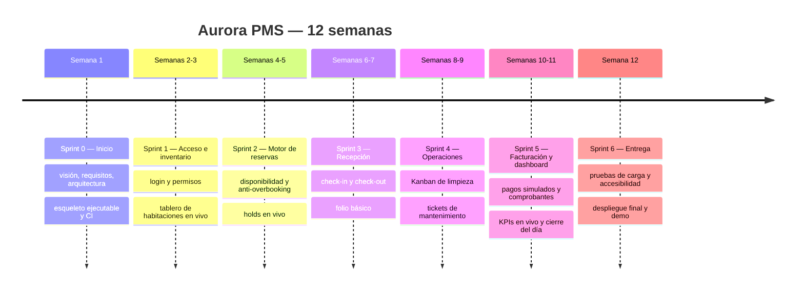
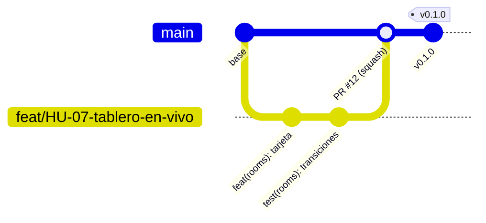

# Plan del proyecto

## 1. Metodología

**Scrum adaptado** a un equipo universitario:

- **Sprints de 2 semanas** (Sprint 0 dura 1 semana). Cada sprint termina con un incremento
  funcional, desplegable y demostrable.
- **Backlog en GitHub Issues** (una historia de usuario = un issue, plantilla en
  `.github/ISSUE_TEMPLATE`) y **tablero en GitHub Projects** con columnas
  `Backlog → Listo → En progreso → En revisión → Hecho`.
- **Hitos (milestones) de GitHub = sprints**, para ver el avance y el burndown de cada uno.
- Estimación en **puntos de historia** (Fibonacci: 1, 2, 3, 5, 8). Una historia de 8 se divide.

### Ceremonias (versión liviana)

| Ceremonia | Cuándo | Duración | Resultado |
| --- | --- | --- | --- |
| Planificación | Primer día del sprint | 45 min | Objetivo del sprint e issues asignados |
| Daily asíncrona | Diario, por el canal del equipo | 5 min | ¿Qué hice? ¿Qué haré? ¿Qué me bloquea? |
| Revisión / demo | Último día del sprint | 30 min | Demo del incremento (idealmente ante el docente) |
| Retrospectiva | Después de la demo | 20 min | 1 cosa a mantener, 1 a cambiar, con responsable |

## 2. Cronograma

| Sprint | Semanas | Objetivo del sprint | Historias (ver [requisitos](../02-analisis/requisitos.md)) | Entregable demostrable |
| --- | --- | --- | --- | --- |
| 0 | 1 | Arrancar con bases sólidas | — | Documentación de fases 1–3, esqueleto que corre, CI en verde |
| 1 | 2–3 | Que el equipo vea el hotel en vivo | HU-01, HU-02, HU-05, HU-06, HU-07, HU-08, HU-09, HU-30, HU-34 | Tablero de habitaciones que se actualiza entre navegadores |
| 2 | 4–5 | Vender sin vender dos veces | HU-11, HU-12, HU-13, HU-14, HU-15 | Prueba de concurrencia: 50 intentos, 1 reserva |
| 3 | 6–7 | Recibir y despedir huéspedes | HU-17, HU-18, HU-19, HU-20, HU-26 | Flujo reserva → check-in → check-out |
| 4 | 8–9 | Operación coordinada | HU-21, HU-22, HU-24, HU-25, HU-32 | Check-out dispara tarea en el celular de limpieza |
| 5 | 10–11 | Cobrar y medir | HU-27, HU-28, HU-29, HU-35, HU-03 | Folio cerrado y dashboard con KPIs en vivo |
| 6 | 12 | Endurecer y entregar | Verificación de RNF, historias *Could* si hay holgura | Despliegue público, demo final, informe |

> El Sprint 6 es también el **colchón** del proyecto: si un sprint anterior se atrasa, las
> historias *Should/Could* se sacrifican antes que la calidad de las *Must*.

### Reajuste del 17 de noviembre de 2026: la guía del docente

La *Guía de Proyecto Web Avanzadas* llegó después de planificar y cambia dos cosas:

1. **El primer bimestre tiene requisitos obligatorios propios**: registro, recuperación de clave,
   CRUD paginado de una entidad principal y un chat con WebSockets (además de lo que ya teníamos:
   login, pantalla principal, tiempo real, seguridad y pruebas). Su entrega es el
   **19 de noviembre de 2026**.
2. **El segundo bimestre exige evolucionar la misma aplicación** a un frontend desacoplado, un
   backend y microservicios, con CI/CD y observabilidad.

Por eso el orden cambia: primero todo lo que la guía pide (cumplido, ver la
[matriz de cumplimiento](../02-analisis/matriz-guia-docente.md)), después las funciones propias del
hotel que más valor demuestran, y en el segundo bimestre la separación en servicios
([ADR-0012](../03-diseno/adr/0012-del-monolito-a-microservicios.md)).

| Etapa | Contenido | Estado |
| --- | --- | --- |
| Sprint 0 | Expediente SDLC, esqueleto, login, permisos, tablero en vivo, bitácora (HU-01, 02, 07, 08, 09, 30, 34) | ✅ Hecho |
| Sprint "Guía" (entrega del primer bimestre) | Registro (HU-39), recuperación de clave (HU-40), CRUD de huéspedes (HU-41), chat (HU-42), rol y estado de usuarios (HU-03 parcial), medición de rendimiento | ✅ Hecho |
| Resto del bimestre 1 / inicio del 2 | Motor de reservas sobre los huéspedes ya registrados (HU-11 a 15), check-in y check-out (HU-17 a 20) | Pendiente |
| Bimestre 2 | API REST + frontend desacoplado; servicios de identidad, huéspedes y chat/notificaciones; *broker* de eventos; CI/CD por servicio; observabilidad | Pendiente: falta la sección del segundo bimestre de la guía para cerrar el alcance |
| Si sobra tiempo | Operaciones (HU-21 a 25), facturación (HU-26 a 28), KPIs (HU-29) | *Could* |

## 3. Roles y responsabilidades

Los roles se reparten según el tamaño del equipo; una persona puede tener varios.

| Rol | Responsabilidades | Rotación |
| --- | --- | --- |
| Product Owner | Representa al docente/cliente, prioriza el backlog, acepta historias | Fijo (o el docente) |
| Scrum Master | Facilita ceremonias, elimina bloqueos, cuida el tablero | Rota cada sprint |
| Líder técnico | Cuida la arquitectura, los ADR y la revisión de PRs críticos | Fijo |
| Dueño de módulo | Lleva un módulo de punta a punta (BD, servicio, vistas, pruebas) | Fijo por módulo |
| QA | Mantiene la estrategia de pruebas y el guion de demo | Rota cada sprint |
| DevOps | CI, despliegue, variables de entorno, backups | Fijo |

**Reparto sugerido de módulos para 3 personas** (ajustar al equipo real):

| Persona | Módulos |
| --- | --- |
| A | Inventario, housekeeping, mantenimiento |
| B | Reservas, recepción |
| C | Facturación, dashboard, infraestructura (CI/despliegue) |

## 4. Definition of Ready y Definition of Done

**Una historia está *lista* para entrar al sprint cuando:**

- [ ] Tiene el formato *Como… quiero… para…* y criterios de aceptación verificables.
- [ ] Sus dependencias (tablas, permisos, pantallas previas) existen o entran en el mismo sprint.
- [ ] Tiene un boceto de UI si cambia una pantalla.
- [ ] Está estimada y cabe en un sprint (≤ 5 puntos; si no, se divide).

**Una historia está *hecha* cuando:**

- [ ] El código está en `main` mediante un PR revisado por al menos otra persona.
- [ ] CI en verde: lint, formato y pruebas.
- [ ] Cada criterio de aceptación tiene al menos una prueba automatizada (o un caso manual documentado si no es automatizable).
- [ ] Funciona sin errores en consola, es usable con teclado y se ve bien en móvil si aplica.
- [ ] La documentación afectada está actualizada (rutas, eventos, modelo de datos, ADR).
- [ ] Está desplegada en el entorno de demo (a partir del Sprint 1).

## 5. Flujo de trabajo con Git

Usamos **GitHub Flow**: `main` siempre funciona y todo cambio entra por Pull Request.

- **Ramas**: `tipo/HU-xx-descripcion-corta`, por ejemplo `feat/HU-12-crear-reserva`,
  `fix/HU-08-version-obsoleta`, `docs/adr-0009`.
- **Commits**: [Conventional Commits](https://www.conventionalcommits.org/es/) con el tipo en inglés y
  la descripción en español: `feat(reservations): bloqueo temporal de fechas`.
- **Pull Requests**: enlazan el issue (`Closes #12`), usan la plantilla con la DoD, requieren CI en
  verde y 1 aprobación. Se integran con *squash merge*.
- **Protección de `main`**: sin push directo; requiere PR, revisión y CI.
- **Versiones**: una etiqueta por sprint cerrado (`v0.1.0` = Sprint 1 … `v1.0.0` = entrega final) y
  el [CHANGELOG](../../CHANGELOG.md) actualizado.

## 6. Herramientas

| Necesidad | Herramienta |
| --- | --- |
| Código, issues, tablero, CI | GitHub (Issues, Projects, Actions) |
| Editor | VS Code + extensiones de ESLint, Prettier y EJS |
| Base de datos local | Docker Compose (PostgreSQL) |
| Pruebas | `node:test`, Supertest, cliente de Socket.IO, Playwright (E2E) |
| Diagramas | Mermaid dentro de Markdown |
| Comunicación | Canal del equipo + reunión semanal |

## 7. Colaboración con asistentes de IA

El equipo puede usar asistentes (Claude, Gemini u otros) como herramienta, con estas reglas:

1. **Todo entra por Pull Request**, sin excepción, y pasa revisión humana.
2. **El feedback cruzado vive en el repositorio**: si un asistente revisa el trabajo de otro, sus
   observaciones se dejan como comentarios de revisión en el PR, y las respuestas o correcciones
   quedan en la misma rama. Así hay trazabilidad de qué se cambió y por qué.

## 8. Gestión de cambios

- Un cambio de alcance se propone como issue con la etiqueta `cambio-de-alcance`; el Product Owner
  decide si entra y qué sale a cambio.
- Un cambio de arquitectura requiere un ADR nuevo (o uno que reemplace a otro) aprobado en PR.
- Nunca se modifica una migración ya aplicada en `main`: se crea una nueva.
