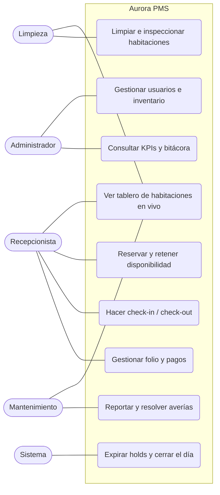

# Especificación de requisitos

Este documento es la referencia para el backlog: cada historia de usuario (`HU-xx`) se convierte en
un issue y cada criterio de aceptación en al menos una prueba.

- **Prioridad**: MoSCoW (*Must* = MVP).
- **Sprint**: planificación tentativa; ver el [plan del proyecto](../01-planificacion/plan-del-proyecto.md).
- Términos del dominio (VC, OOO, folio, ADR…): ver el [glosario](glosario.md).

## 1. Actores

| Actor | Descripción | Rol en el sistema |
| --- | --- | --- |
| Administrador | Gerente o supervisor del hotel | `admin` |
| Recepcionista | Atiende reservas, llegadas, salidas y cobros | `front_desk` |
| Personal de limpieza | Limpia habitaciones; trabaja desde el celular | `housekeeping` |
| Técnico de mantenimiento | Atiende averías | `maintenance` |
| Huésped | Cliente del hotel (portal opcional) | — |
| Sistema | Procesos automáticos: expirar retenciones, auditoría nocturna | — |

### Matriz de permisos (resumen)

| Capacidad | admin | front_desk | housekeeping | maintenance |
| --- | :-: | :-: | :-: | :-: |
| Ver tablero de habitaciones | ✅ | ✅ | ✅ | ✅ |
| Cambiar estado de limpieza | ✅ | Solo marcar sucia | Sucia → En limpieza → Limpia | — |
| Inspeccionar habitación | ✅ | — | — | — |
| Fuera de servicio (OOO) | ✅ | — | — | ✅ |
| Reservas, check-in/out, cobros | ✅ | ✅ | — | — |
| Ver bitácora de actividad | ✅ | ✅ | — | — |
| Ver y gestionar huéspedes (CRUD) | ✅ | ✅ | — | — |
| Chat: sala General | ✅ | ✅ | ✅ | ✅ |
| Chat: salas Limpieza / Mantenimiento | ✅ / ✅ | ✅ / ✅ | ✅ / — | — / ✅ |
| Gestionar usuarios e inventario | ✅ | — | — | — |

Quien crea su propia cuenta (HU-39) entra como **front_desk** (Recepción).

El detalle de cada transición está en [máquinas de estado](../03-diseno/maquinas-de-estado.md).

## 2. Requisitos funcionales (historias de usuario)

Formato de los criterios: **Dado** (contexto) **cuando** (acción) **entonces** (resultado).

### E1 — Acceso y seguridad

#### HU-01 Iniciar y cerrar sesión · *Must* · Sprint 1

Como **miembro del personal**, quiero **iniciar sesión con mi correo y contraseña** para **acceder
solo a las funciones de mi rol**.

1. Dado un usuario activo con credenciales válidas, cuando inicia sesión, entonces llega a su panel y
   la sesión dura como máximo un turno (8 h de inactividad).
2. Dadas credenciales inválidas o un usuario inactivo, cuando intenta iniciar sesión, entonces ve el
   mensaje genérico "Correo o contraseña incorrectos" (sin revelar cuál falló).
3. Dados 10 intentos fallidos desde la misma IP en 15 minutos, cuando intenta de nuevo, entonces
   recibe un error 429 hasta que pase la ventana.
4. Dado un usuario con sesión iniciada, cuando cierra sesión, entonces su sesión se invalida y sus
   conexiones en tiempo real se desconectan.
5. Dado un visitante sin sesión, cuando abre una página interna, entonces es redirigido al login.

#### HU-02 Control de acceso por permisos · *Must* · Sprint 1

Como **administrador**, quiero que **cada pantalla y acción verifique permisos en el servidor** para
**que nadie haga lo que no le corresponde aunque manipule el HTML**.

1. Dado un usuario sin permiso, cuando solicita una ruta o acción protegida, entonces recibe 403 y no
   se modifica ningún dato.
2. Dado cualquier usuario, cuando ve una pantalla, entonces solo aparecen los botones de las acciones
   que puede ejecutar.

#### HU-03 Gestión de usuarios · *Should* 

Como **administrador**, quiero **crear, editar y desactivar usuarios** para **controlar quién accede**.

1. Dado un usuario desactivado, cuando intenta usar una sesión existente, entonces pierde el acceso y
   sus sockets se desconectan.
2. El correo es único (sin distinguir mayúsculas).
3. ✅ Dado un administrador, cuando cambia el rol de alguien, entonces sus pestañas abiertas se
   recargan con los permisos nuevos y el cambio queda en la bitácora.
4. ✅ Nadie puede cambiar su propio rol ni desactivar su propia cuenta.

#### HU-39 Registrarme (SignUp) · *Must* 

Como **persona que empieza a trabajar en el hotel**, quiero **crear mi cuenta** para **usar el
sistema sin esperar a que alguien me la cree**.

1. Dado el formulario de registro, cuando envío nombre y apellido, correo y una contraseña válida
   (10+ caracteres, letras y números) con su confirmación, entonces se crea mi cuenta con el rol
   **Recepción** y entro directamente a la pantalla principal.
2. Dado un dato inválido, cuando envío el formulario, entonces veo un mensaje claro junto a cada
   campo con problemas (primero en el navegador y, si este se salta, también desde el servidor) y
   se conservan los datos que escribí, salvo la contraseña.
3. Dado un correo que ya tiene cuenta (sin importar mayúsculas), cuando me registro, entonces se me
   avisa y no se crea otra.
4. Dada una cuenta nueva, entonces administración recibe un aviso en tiempo real y queda registrado
   en la bitácora.
5. Dadas más de 10 cuentas creadas en una hora desde la misma conexión, entonces se rechazan las
   siguientes.

#### HU-40 Recuperar mi clave · *Must* 

Como **miembro del personal**, quiero **restablecer mi clave si la olvidé** para **volver a entrar
sin pedir ayuda**.

1. Dado mi correo, cuando pido el enlace, entonces recibo (correo simulado) un enlace que caduca en
   30 minutos y solo sirve una vez; la pantalla dice lo mismo exista o no la cuenta.
2. Dado un enlace vigente, cuando elijo una clave nueva válida, entonces se guarda, el enlace deja de
   servir y se cierran mis sesiones abiertas en otros dispositivos.
3. Dado un enlace caducado, usado o reemplazado por uno más reciente, cuando lo abro, entonces se me
   ofrece pedir uno nuevo.

#### HU-04 Cambiar mi contraseña · *Could*

Como **miembro del personal**, quiero **cambiar mi contraseña** para **mantener mi cuenta segura**.

### E2 — Inventario y estado de habitaciones

#### HU-05 Gestionar tipos de habitación · *Must* · Sprint 1

Como **administrador**, quiero **definir tipos de habitación con tarifa base y capacidad** para
**ofrecerlos en las reservas**.

1. El código del tipo es único (2–5 letras mayúsculas), la tarifa es ≥ 0 y la capacidad está entre 1 y 12.

#### HU-06 Gestionar habitaciones · *Must* · Sprint 1

Como **administrador**, quiero **registrar habitaciones con número, piso y tipo** para **tener el
inventario real del hotel**.

1. El número de habitación es único.
2. Una habitación con reservas futuras no se elimina: se desactiva.

#### HU-07 Tablero de habitaciones en vivo · *Must* · Sprint 1

Como **recepcionista**, quiero **ver todas las habitaciones agrupadas por piso con su estado
combinado** para **saber cuáles puedo asignar sin preguntar a nadie**.

1. Cada habitación muestra su código de estado (VI, VC, VD, OC, OD, OOO) con texto e ícono, no solo
   con color.
2. Hay contadores por estado y filtros que no recargan la página.
3. Dado que otro usuario cambia el estado de una habitación, cuando el cambio se confirma, entonces la
   tarjeta y los contadores se actualizan en menos de 1 s sin recargar.
4. Los cambios en vivo se anuncian a lectores de pantalla (región `aria-live`).
5. Si la conexión se pierde, se muestra un indicador; al reconectar, la vista se resincroniza.

#### HU-08 Cambiar estado de limpieza · *Must* · Sprint 1

Como **personal de limpieza**, quiero **marcar una habitación como "en limpieza" y luego "limpia"**
para **que recepción sepa que está lista**.

1. Solo se permiten las transiciones definidas en la máquina de estados y según el rol.
2. Dado que dos personas cambian la misma habitación casi a la vez, cuando la segunda envía su
   cambio con una versión obsoleta, entonces recibe un conflicto (409) y ve el estado actual.
3. Cada cambio queda en la bitácora con usuario, fecha, estado anterior y nuevo.
4. Funciona también sin JavaScript (formulario tradicional con redirección).

#### HU-09 Marcar habitación fuera de servicio · *Must* · Sprint 1

Como **técnico de mantenimiento**, quiero **bloquear una habitación con un motivo** para **que no
se venda mientras está averiada**.

1. El motivo es obligatorio (3–200 caracteres) al bloquear.
2. Una habitación fuera de servicio (OOO) no cuenta como disponible ni se puede asignar.
3. Al liberarla, vuelve a su estado de limpieza anterior.

#### HU-10 Tarifas por temporada · *Could*

Como **administrador**, quiero **definir tarifas por rango de fechas y día de la semana** para
**cobrar más en temporada alta**.

### E3 — Reservas

#### HU-11 Buscar disponibilidad · *Must* · Sprint 2

Como **recepcionista**, quiero **buscar habitaciones libres por fechas y número de huéspedes** para
**ofrecer opciones con su precio total**.

1. Noches = fecha de salida − fecha de llegada (mínimo 1); la llegada no puede ser anterior a la fecha
   de negocio.
2. Se excluyen habitaciones con reservas o retenciones solapadas y habitaciones OOO en el rango.
3. Se muestra el total = suma de tarifas por noche + impuesto configurable.

#### HU-12 Crear reserva · *Must* · Sprint 2

Como **recepcionista**, quiero **registrar una reserva con los datos del huésped** para **confirmar
la estancia**.

1. Se genera un código de confirmación único y legible (por ejemplo `AUR-7K3Q`).
2. Dadas dos solicitudes simultáneas por la misma habitación y fechas, cuando ambas se procesan,
   entonces exactamente una tiene éxito y la otra recibe 409 (garantizado por la base de datos).

#### HU-13 Retención temporal (hold) en vivo · *Must* · Sprint 2

Como **recepcionista**, quiero que **al seleccionar una habitación para unas fechas quede retenida
unos minutos** para **que nadie me la quite mientras lleno los datos del huésped**.

1. La retención dura 10 minutos y bloquea igual que una reserva.
2. Los demás usuarios ven la habitación como "en proceso de reserva" en vivo.
3. Al expirar o cancelarse, la disponibilidad se libera en vivo para todos.

#### HU-14 Modificar o cancelar reserva · *Should* · Sprint 2

Como **recepcionista**, quiero **cambiar fechas o cancelar una reserva** para **atender cambios del
huésped**. Las fechas liberadas vuelven a estar disponibles en vivo.

#### HU-15 Calendario de ocupación (rack) · *Should* · Sprint 2

Como **recepcionista**, quiero **ver una grilla de habitaciones × días con las reservas** para
**planificar asignaciones de un vistazo**. Se actualiza en vivo.

#### HU-16 No-show · *Could*

Como **sistema**, quiero **marcar como no-show las reservas confirmadas que no llegaron** al cerrar el
día, para **liberar el inventario**.

### E4 — Recepción

#### HU-17 Check-in · *Must* · Sprint 3

Como **recepcionista**, quiero **registrar la llegada del huésped** para **entregarle la habitación**.

1. Solo reservas confirmadas con llegada igual o anterior a la fecha de negocio.
2. La habitación debe estar vacante y limpia o inspeccionada (VC/VI); si no, se ofrece cambiarla.
3. La habitación pasa a ocupada y se abre el folio de la estancia.

#### HU-18 Check-out · *Must* · Sprint 3

Como **recepcionista**, quiero **registrar la salida** para **liberar la habitación y cerrar la cuenta**.

1. Requiere saldo cero en el folio (o autorización de un administrador).
2. La habitación pasa a vacante sucia (VD) y se crea automáticamente una tarea de limpieza.
3. Limpieza recibe la tarea en vivo.

#### HU-19 Walk-in · *Should* · Sprint 3

Como **recepcionista**, quiero **crear una reserva y hacer check-in en un solo paso** para huéspedes
sin reserva.

#### HU-20 Llegadas y salidas del día · *Must* · Sprint 3

Como **recepcionista**, quiero **listas en vivo de llegadas y salidas de hoy** para **organizar el turno**.

### E5 — Housekeeping

#### HU-21 Tablero Kanban de limpieza · *Must* · Sprint 4

Como **personal de limpieza**, quiero **ver mis tareas en columnas Pendiente / En curso / Hecha**
desde el celular para **saber qué hacer sin preguntar**.

1. Usable en pantallas de 360 px de ancho.
2. Al mover una tarea, el estado de la habitación cambia y recepción lo ve en vivo.

#### HU-22 Asignar tareas · *Should* · Sprint 4

Como **administrador**, quiero **asignar tareas a una persona** para **repartir la carga**; la
persona recibe una notificación.

#### HU-23 Inspección · *Could*

Como **administrador**, quiero **inspeccionar una habitación limpia** antes de liberarla a la venta.

### E6 — Mantenimiento

#### HU-24 Reportar avería · *Must* · Sprint 4

Como **cualquier miembro del personal**, quiero **reportar una avería con prioridad** para **que
mantenimiento la atienda**.

#### HU-25 Gestionar ticket · *Must* · Sprint 4

Como **técnico de mantenimiento**, quiero **mover el ticket por sus estados** para **informar el
avance**. Un ticket marcado "bloquea habitación" la pone OOO hasta resolverse.

### E7 — Facturación

#### HU-26 Folio de la estancia · *Must* · Sprint 3

Como **recepcionista**, quiero **ver el estado de cuenta con cargos por noche, extras e impuestos**
para **cobrar correctamente**. El saldo se calcula, no se guarda.

#### HU-27 Registrar pago simulado · *Must* · Sprint 5

Como **recepcionista**, quiero **registrar pagos en efectivo o tarjeta simulada** para **dejar el
saldo en cero**. Nunca se guardan datos reales de tarjetas.

#### HU-28 Comprobante imprimible · *Should* · Sprint 5

Como **recepcionista**, quiero **imprimir el comprobante** con estilos de impresión limpios.

### E8 — Dashboard e informes

#### HU-29 KPIs en vivo · *Must* · Sprint 5

Como **administrador**, quiero **ver ocupación, ADR, RevPAR, llegadas, salidas y habitaciones OOO**
para **tomar decisiones del día**. Se actualizan solos con cada operación.

#### HU-30 Bitácora de actividad · *Should* · Sprint 1

Como **administrador**, quiero **un feed en vivo de quién hizo qué y cuándo** para **auditar la
operación**.

#### HU-31 Reportes por rango · *Could*

Como **administrador**, quiero **exportar ocupación e ingresos por rango de fechas a CSV**.

### E9 — Tiempo real transversal

#### HU-32 Notificaciones persistentes · *Should* · Sprint 4

Como **miembro del personal**, quiero **recibir notificaciones aunque esté desconectado** para
**verlas al volver**.

#### HU-33 Presencia · *Could*

Como **recepcionista**, quiero **ver quién más está viendo una reserva** para **evitar ediciones
simultáneas**.

> Base implementada en el Bimestre 1: la lista "Conectados ahora" del chat (HU-42) usa el mismo
> registro de presencia (`src/realtime/presence.js`). Falta la presencia por reserva.

#### HU-34 Indicador de conexión y resincronización · *Must* · Sprint 1

Como **usuario**, quiero **saber si estoy viendo datos en vivo** para **no confiar en información
vieja**.

1. Indicador visible: conectado / reconectando / sin conexión.
2. Al reconectar sin poder recuperar los eventos perdidos, la vista se resincroniza sola.

### E10 — Cierre diario

#### HU-35 Auditoría nocturna · *Should* · Sprint 5

Como **administrador**, quiero **cerrar el día** para **cargar las noches a los folios, marcar
no-shows y avanzar la fecha de negocio**, con un resumen del cierre.

### E11 — Portal del huésped (*Could*)

- **HU-36** Consultar reserva con código y apellido.
- **HU-37** Pre-check-in en línea.
- **HU-38** Chat en vivo con recepción.

### E12 — Huéspedes (entidad principal del CRUD)

#### HU-41 Gestionar huéspedes · *Must* · Bimestre 1 · Guía 3.3

Como **recepcionista**, quiero **registrar, buscar, consultar, actualizar y eliminar huéspedes** para
**tener sus datos correctos al reservar y al hacer el check-in**.

1. Dado el listado, entonces está paginado (10, 25 o 50 por página) y puedo buscar por nombre,
   documento o correo sin importar mayúsculas ni tildes, y filtrar por nacionalidad.
2. Dado un identificador, cuando lo consulto, entonces veo la ficha del huésped (o un 404 si no existe).
3. Dados los 9 atributos del huésped, cuando registro o edito, entonces se validan tipos, formatos y
   longitudes en el navegador y en el servidor: cédula ecuatoriana con dígito verificador o
   pasaporte, correo, teléfono (se guarda en formato internacional), fecha de nacimiento (mayor de
   edad), nacionalidad y notas (máx. 500).
4. Dado un documento ya registrado, cuando intento usarlo de nuevo, entonces se rechaza con un
   enlace a la ficha existente.
5. Dado que otra persona modificó el huésped mientras yo lo editaba, cuando guardo, entonces se me
   avisa y se muestran los datos actuales (no se sobrescribe a ciegas).
6. Dado un huésped, cuando elijo eliminarlo, entonces se me pide confirmación antes de borrarlo y la
   acción queda en la bitácora.
7. Limpieza y mantenimiento no ven datos personales de huéspedes.

### E13 — Comunicación del personal

#### HU-42 Chat del personal en tiempo real · *Must* · Bimestre 1 · Guía 3.3

Como **miembro del personal**, quiero **conversar en tiempo real con mis compañeros** para
**coordinar habitaciones, pedidos y averías sin salir del sistema**.

1. Dadas dos personas conectadas a la misma sala, cuando una envía un mensaje, entonces la otra lo
   ve al instante sin recargar la página.
2. Existe una sala **General** para todo el personal, y salas de **Limpieza** y **Mantenimiento**
   solo para los roles que coordinan esas áreas.
3. El historial se guarda en la base de datos: quien entra después lo ve, y quien se reconecta recibe
   lo que se perdió.
4. Se muestra quién está conectado en este momento.
5. Quien no tiene la sala abierta recibe un aviso de mensaje nuevo y una insignia con los mensajes
   sin leer en el menú.
6. Los mensajes se validan y sanean en el servidor (1 a 1000 caracteres, sin caracteres invisibles)
   y se muestran siempre como texto; como máximo 8 mensajes cada 10 segundos por persona.
7. Sin JavaScript, el chat sigue funcionando con un formulario normal.

## 3. Requisitos no funcionales

| ID | Categoría | Requisito | Verificación |
| --- | --- | --- | --- |
| RNF-01 | Rendimiento | p95 < 300 ms en páginas SSR y < 150 ms en acciones, con los datos semilla | Prueba de carga (autocannon) en Sprint 6 |
| RNF-02 | Tiempo real | Propagación de cambios entre clientes p95 < 1 s en red local | Prueba E2E con 2 navegadores |
| RNF-03 | Integridad | 0 reservas solapadas con 50 solicitudes concurrentes; ningún cambio de estado perdido | Prueba de concurrencia en CI |
| RNF-04 | Seguridad | Contraseñas con scrypt, sesiones HttpOnly + SameSite, CSRF, CSP, limitación de intentos, SQL parametrizado, permisos en servidor | Lista de verificación de [seguridad](../03-diseno/seguridad.md) + pruebas |
| RNF-05 | Accesibilidad | WCAG 2.2 AA en pantallas principales; uso completo con teclado; estado no transmitido solo por color | Revisión con axe + navegación con teclado |
| RNF-06 | Usabilidad móvil | Pantallas de limpieza usables desde 360 px de ancho | Prueba manual en celular y E2E con viewport móvil |
| RNF-07 | Compatibilidad | Últimas 2 versiones de Chrome, Firefox, Safari y Edge | Prueba manual en la demo |
| RNF-08 | Mantenibilidad | 0 errores de ESLint, formato Prettier, cobertura ≥ 70 % en servicios | CI |
| RNF-09 | Portabilidad | Entorno local listo en < 10 min con Docker Compose y un comando de setup | Prueba con un integrante nuevo |
| RNF-10 | Observabilidad | Logs estructurados con id de petición; endpoint `/health` | Revisión de logs en la demo |
| RNF-11 | Localización | Interfaz en español; fechas y moneda formateadas con `Intl` | Revisión de UI |
| RNF-12 | Privacidad | Datos mínimos del huésped; sin datos reales de tarjetas | Revisión del modelo de datos |

## 4. Reglas de negocio

| ID | Regla |
| --- | --- |
| RN-01 | Las fechas de estancia son días sin hora; una estancia ocupa el rango semiabierto `[llegada, salida)`. Noches = salida − llegada ≥ 1. |
| RN-02 | Una habitación no puede tener dos reservas activas (retenida, confirmada o en casa) que se solapen. Lo garantiza la base de datos. |
| RN-03 | Una retención (hold) expira a los 10 minutos y, mientras está vigente, bloquea como una reserva. |
| RN-04 | Una habitación fuera de servicio no se vende ni cuenta como disponible en los KPIs. |
| RN-05 | Check-in solo en habitación vacante y limpia/inspeccionada. El check-out la deja vacante y sucia. |
| RN-06 | Los montos se guardan en centavos (enteros) y el impuesto es configurable. |
| RN-07 | Toda acción que cambia el estado del hotel queda en la bitácora con usuario y fecha. |
| RN-08 | La fecha de negocio la avanza la auditoría nocturna, no el reloj del servidor. |
| RN-09 | Horario estándar: check-in desde las 15:00 y check-out hasta las 12:00 (configurable). |
| RN-10 | Una habitación ocupada no se puede poner fuera de servicio: primero se cambia al huésped de habitación. |

## 5. Trazabilidad

| Requisito | Módulo | Pruebas |
| --- | --- | --- |
| HU-01 | `auth` | `test/integration/auth.test.js` |
| HU-02 | `core/permissions`, middlewares | `test/integration/auth.test.js`, `test/integration/rooms.test.js` |
| HU-07 | `rooms`, `realtime` | `test/integration/realtime.test.js`, `test/e2e` (Sprint 6) |
| HU-08 | `rooms` | `test/unit/room-status.test.js`, `test/integration/rooms.test.js` |
| HU-09 | `rooms` | `test/integration/rooms.test.js` |
| HU-30 | `audit` | `test/integration/rooms.test.js`, `test/integration/realtime.test.js` |
| HU-34 | `public/js/app.js` | Prueba manual + E2E (Sprint 6) |
| HU-03 | `users`, `auth` | `test/integration/users.test.js`, `test/integration/chat.test.js` |
| HU-39 | `auth` | `test/integration/signup.test.js`, `test/integration/chat.test.js` |
| HU-40 | `auth`, `mail` | `test/integration/password-reset.test.js` |
| HU-41 | `guests` | `test/integration/guests.test.js`, `test/unit/guest-schema.test.js`, `test/unit/validators.test.js` |
| HU-42 | `chat`, `realtime` | `test/integration/chat.test.js`, `test/unit/chat.test.js` |
| RNF-03 | `rooms` (y `reservations` en Sprint 2) | `test/integration/rooms.test.js` (concurrencia) |

La tabla crece con cada sprint; una historia sin fila aquí no cumple la Definition of Done.
