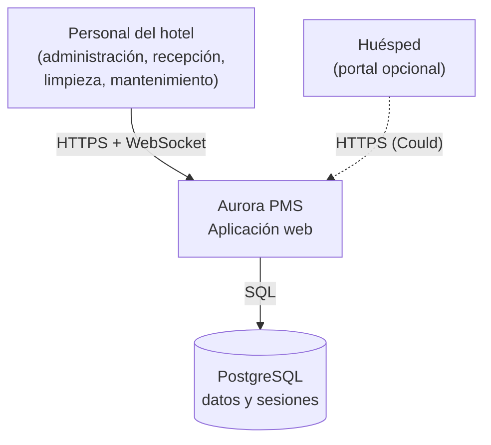
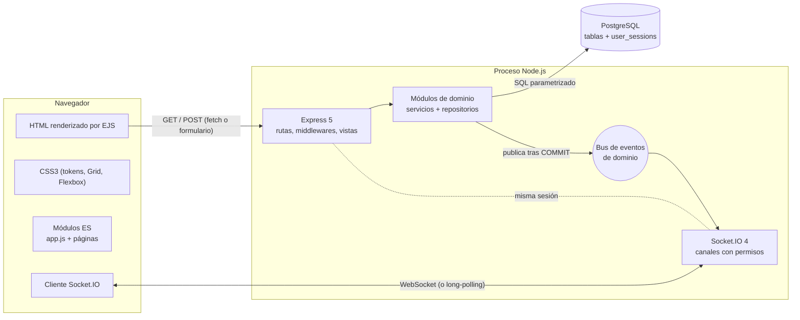
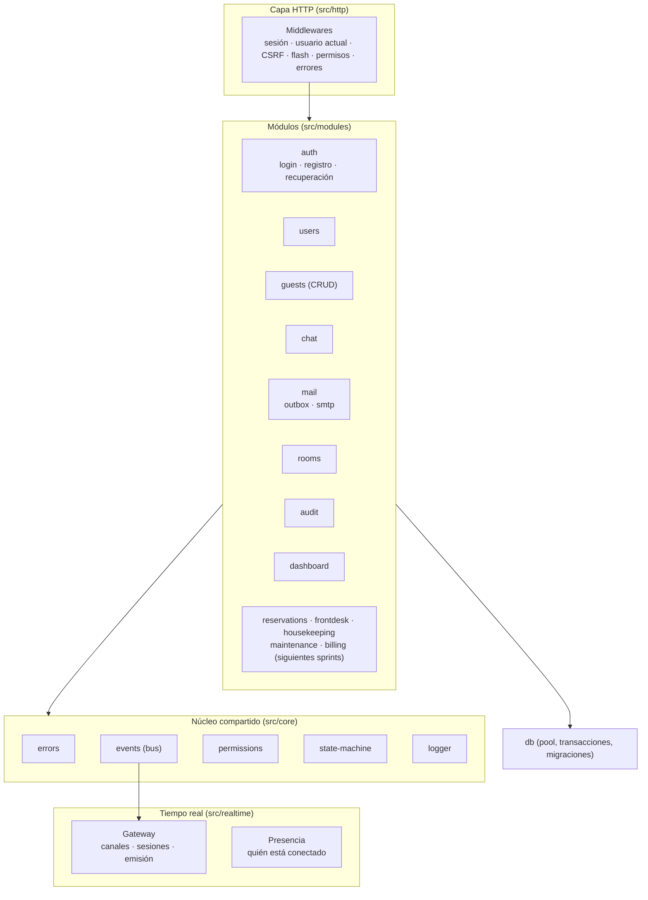
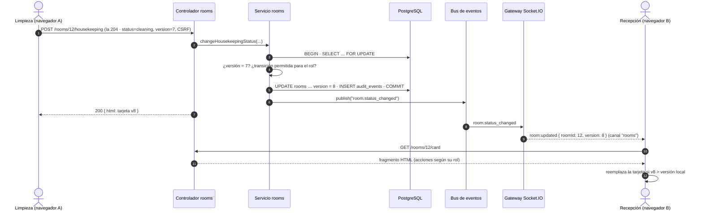

# Arquitectura

## 1. Estilo arquitectónico

Aurora PMS es un **monolito modular con renderizado en el servidor (SSR) y una capa de tiempo real**.
Cumple la definición de aplicación monolítica de la guía del curso (vistas y rutas en el servidor,
un solo proyecto desplegable, WebSocket en el mismo proceso): ver la
[matriz de cumplimiento](../02-analisis/matriz-guia-docente.md). "Modular" se refiere a cómo está
ordenado el código por dentro, lo que prepara la evolución a microservicios del segundo bimestre
([ADR-0012](adr/0012-del-monolito-a-microservicios.md)).

Tres principios guían todas las decisiones:

1. **Un módulo por dominio de negocio** (`rooms`, `reservations`, `housekeeping`…), cada uno con sus
   propias capas internas. El dueño de un módulo puede trabajar sin pisar a los demás.
2. **Comandos por HTTP, eventos por WebSocket.** Toda acción que cambia datos es una petición HTTP
   (con sesión, CSRF, validación y permisos de Express). Socket.IO solo *avisa* a los demás clientes
   de que algo cambió. Ver [ADR-0005](adr/0005-comandos-http-eventos-websocket.md). La única
   excepción es el chat, cuyos mensajes viajan por el socket con la misma validación
   ([ADR-0011](adr/0011-chat-por-websocket.md)).
3. **El servidor es la única fuente de verdad del HTML.** Las actualizaciones en vivo insertan
   fragmentos renderizados con las mismas plantillas EJS que la página completa. Ver
   [ADR-0006](adr/0006-html-over-the-wire.md).

## 2. Contexto (C4 — nivel 1)



## 3. Contenedores (C4 — nivel 2)



## 4. Componentes (C4 — nivel 3)



### Capas dentro de un módulo

```text
rooms.routes.js      → define URLs y qué middleware/permiso aplica
rooms.controller.js  → traduce HTTP ↔ servicio: lee req, decide si responde HTML, fragmento o JSON
rooms.service.js     → reglas de negocio y transacciones; publica eventos de dominio
rooms.repository.js  → SQL puro; recibe el "ejecutor" (pool o cliente de una transacción)
rooms.realtime.js    → se suscribe a eventos de dominio y los envía a canales de Socket.IO
room-status.js       → lógica pura (máquina de estados, códigos de estado); sin I/O, fácil de probar
rooms.schemas.js     → validación de entradas con zod
```

Reglas de dependencia:

- Un **controlador** nunca escribe SQL; un **repositorio** nunca conoce `req`/`res`.
- Un **servicio** no conoce Socket.IO: publica eventos en el bus y otros reaccionan.
- Las **vistas** no contienen reglas de negocio: reciben datos ya calculados (por ejemplo, qué
  acciones están permitidas para el usuario).
- Un módulo usa a otro solo a través de su **servicio**, nunca de su repositorio.

## 5. Flujo de un comando en tiempo real

Ejemplo: limpieza marca la habitación 204 como "en limpieza" mientras recepción tiene el tablero
abierto.



Puntos clave:

- El evento se publica **después del COMMIT**: nunca se anuncia algo que luego se revierte.
- El evento es **delgado** (id + versión): cada cliente pide su fragmento con *sus* permisos.
- La **versión** permite descartar respuestas que llegan desordenadas.

## 6. Estrategia de renderizado

| Situación | Técnica | Ejemplo |
| --- | --- | --- |
| Carga de una página | SSR completo con layout | `GET /rooms` |
| Acción del usuario con JS | `fetch` + respuesta JSON con fragmento HTML | Botón "Iniciar limpieza" |
| Acción del usuario sin JS | Formulario tradicional + redirección 303 + mensaje flash | Mismo botón con JS desactivado |
| Cambio hecho por otro usuario, vista dependiente de permisos | Evento delgado + `GET` del fragmento | Tarjeta de habitación |
| Cambio de otro usuario, vista igual para todos | Evento con datos + `<template>` + `textContent` | Ítem de la bitácora |
| Reconexión sin recuperar eventos, o página con muchos datos derivados | Resincronizar `<main>` con la cabecera `X-Partial: main` | Dashboard |

## 7. Estructura de carpetas

```text
├── migrations/               SQL versionado (001_…sql, 002_…sql)
├── scripts/                  migrate.js, seed.js
├── src/
│   ├── main.js               punto de entrada (npm start): arranca y apaga de forma ordenada
│   ├── server.js             startServer(): HTTP + Socket.IO sobre el mismo puerto
│   ├── app.js                createApp(): Express, middlewares y rutas
│   ├── container.js          composition root: crea db, bus, servicios y los conecta
│   ├── config/env.js         lee y valida variables de entorno
│   ├── core/                 errores, bus de eventos, permisos, máquina de estados, logger
│   ├── db/                   pool, transacciones, migrador
│   ├── http/middlewares/     sesión, usuario actual, CSRF, flash, permisos, errores
│   ├── modules/<dominio>/    routes · controller · service · repository · realtime · schemas
│   │                         (auth, users, guests, chat, mail, rooms, audit, dashboard, health)
│   ├── realtime/             servidor Socket.IO, canales y gateway
│   ├── views/                layouts/, partials/, <módulo>/, errors/
│   └── public/               css/, js/ (módulos ES; js/lib: validadores compartidos con el servidor), img/
├── test/                     unit/, integration/, helpers/
└── docs/                     expediente del SDLC
```

## 8. Composition root e inyección de dependencias

`src/container.js` crea una sola vez las piezas compartidas (pool de base de datos, bus de eventos,
gateway de tiempo real) y se las pasa a cada módulo mediante funciones *factory*
(`createRoomsService({ db, events })`). No se usa un framework de inyección: la ventaja es que las
pruebas pueden construir el mismo contenedor apuntando a la base de datos de pruebas.

## 9. Manejo de errores y observabilidad

- Los errores de negocio son clases con código HTTP (`ConflictError` → 409, `ForbiddenError` → 403,
  `ValidationError` → 422). Express 5 propaga los errores de funciones `async` al manejador central.
- El manejador central responde JSON a `fetch`, página de error a navegación normal, y en un `POST`
  sin JS redirige con un mensaje flash.
- Logs estructurados con `pino` y un identificador por petición; `GET /health` verifica la base de datos.

## 10. Escalabilidad (más allá del curso)

Una sola instancia de Node atiende sin problema a un hotel. Si se necesitaran varias instancias:

1. Socket.IO necesitaría un *adapter* compartido; como ya usamos PostgreSQL, el candidato natural es
   `@socket.io/postgres-adapter` (usa `LISTEN/NOTIFY`).
2. El balanceador debe usar *sticky sessions* si se mantiene el transporte de long-polling.
3. Las sesiones ya viven en PostgreSQL, así que no hay estado de sesión en memoria.
4. Los procesos programados (expirar holds, auditoría nocturna) deben ejecutarse en una sola
   instancia (bloqueo consultivo de PostgreSQL).
5. La presencia del chat y el límite de frecuencia de mensajes viven en memoria del proceso: con
   varias instancias deben compartirse (PostgreSQL o Redis).

## 11. Decisiones relacionadas

Ver el [índice de ADR](adr/README.md).
