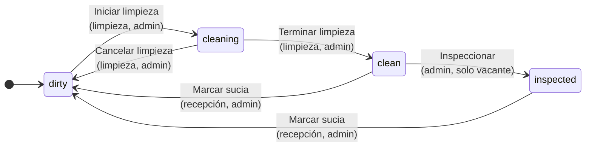
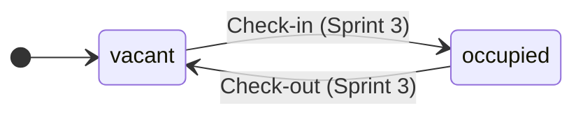
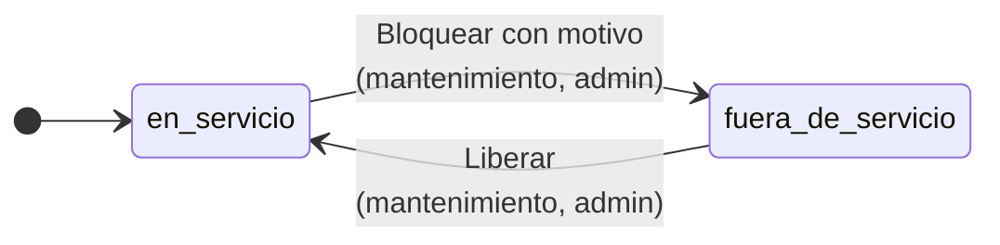
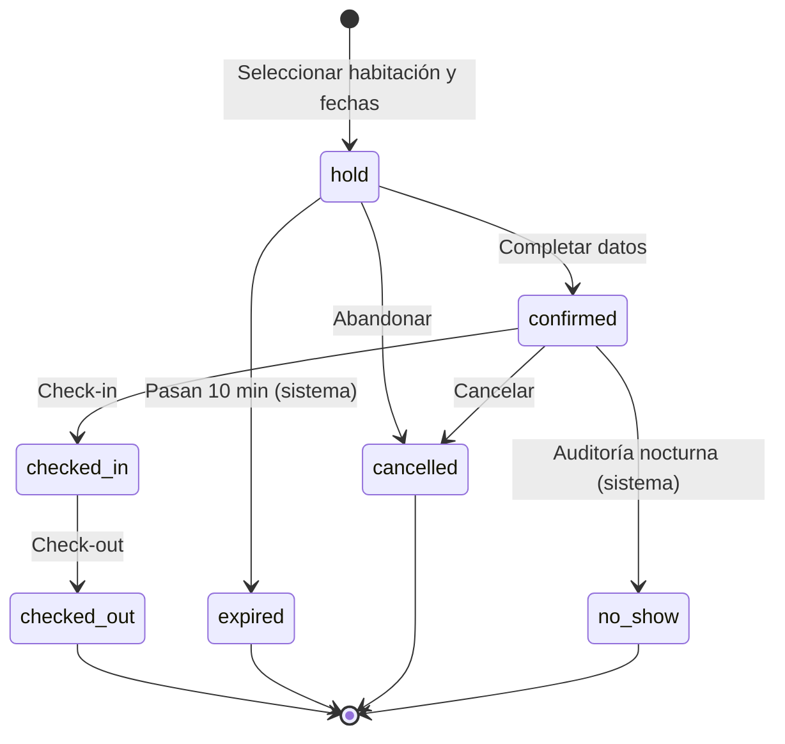
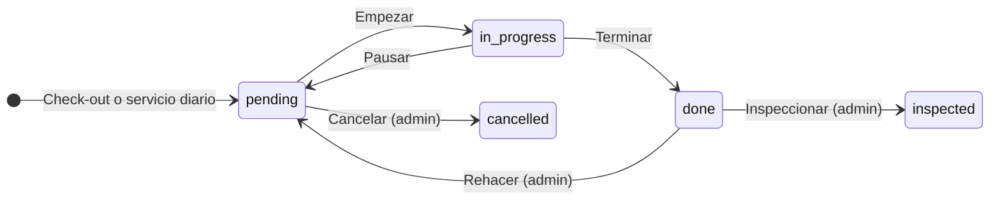
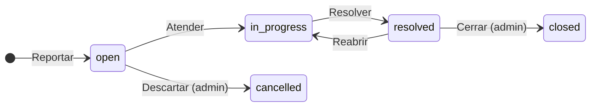

# Máquinas de estado

Las entidades con ciclo de vida se modelan como **máquinas de estados finitos**. En el código se
declaran con `defineStateMachine()` (`src/core/state-machine.js`) y esa misma declaración se usa
para tres cosas, de modo que nunca se contradicen:

1. **Validar** en el servicio que una transición es legal y que el rol puede ejecutarla.
2. **Dibujar** en la vista solo los botones de las transiciones disponibles para el usuario.
3. **Probar** de forma exhaustiva las transiciones permitidas y prohibidas.

## 1. Habitación

El estado de una habitación tiene **tres dimensiones independientes**, como en la operación real de
un hotel. Mezclarlas en un solo estado ("Disponible, Ocupada, Sucia…") obliga a duplicar estados
(¿ocupada *y* sucia?) y a perder información.

### 1.1 Limpieza (`housekeeping_status`)

| Desde | Hacia | Acción | Roles |
| --- | --- | --- | --- |
| `dirty` (Sucia) | `cleaning` (En limpieza) | Iniciar limpieza | `housekeeping`, `admin` |
| `cleaning` | `clean` (Limpia) | Terminar limpieza | `housekeeping`, `admin` |
| `cleaning` | `dirty` | Cancelar limpieza | `housekeeping`, `admin` |
| `clean` | `inspected` (Inspeccionada) | Inspeccionar (solo si la habitación está vacante) | `admin` |
| `clean` | `dirty` | Marcar sucia | `front_desk`, `admin` |
| `inspected` | `dirty` | Marcar sucia | `front_desk`, `admin` |

"Inspeccionar" tiene una **condición** (*guard*): solo aplica a habitaciones vacantes, porque la
inspección es el último paso antes de asignarla a un huésped. Las condiciones se declaran junto a la
transición, así el botón no aparece y el servidor rechaza el comando con el mismo motivo.

A partir del Sprint 3, el **check-out** marca la habitación como `dirty` automáticamente, y en el
Sprint 4 las transiciones de limpieza se harán desde las tareas del Kanban.

### 1.2 Ocupación (`occupancy_status`)

Solo la cambian el check-in y el check-out dentro de la misma transacción que actualiza la reserva.
No hay botón para cambiarla a mano.

### 1.3 Disponibilidad (`is_out_of_order`)

- Bloquear exige un motivo (3–200 caracteres).
- No se puede bloquear una habitación **ocupada** (RN-10).
- Bloquear no cambia el estado de limpieza: al liberar, la habitación vuelve a como estaba.
- En el Sprint 4, un ticket de mantenimiento con "bloquea habitación" usará esta misma transición.

### 1.4 Estado combinado (lo que ve el usuario)

| Código | Etiqueta | Condición | ¿Asignable a una llegada? |
| --- | --- | --- | :-: |
| `OOO` | Fuera de servicio | `is_out_of_order` | No |
| `VI` | Vacante inspeccionada | vacante + `inspected` | Sí |
| `VC` | Vacante limpia | vacante + `clean` | Sí |
| `VD` | Vacante sucia | vacante + `dirty` o `cleaning` | No |
| `OC` | Ocupada limpia | ocupada + `clean` o `inspected` | — |
| `OD` | Ocupada sucia | ocupada + `dirty` o `cleaning` | — |

"En limpieza" se muestra como detalle dentro de VD/OD para no inventar códigos que la industria no usa.

## 2. Reserva (Sprint 2–3)

Solo `hold`, `confirmed` y `checked_in` ocupan inventario (participan en la restricción de exclusión).

## 3. Tarea de limpieza (Sprint 4)

Mover una tarea sincroniza el estado de limpieza de la habitación (`pending` → `dirty`,
`in_progress` → `cleaning`, `done` → `clean`, `inspected` → `inspected`).

## 4. Ticket de mantenimiento (Sprint 4)

Si el ticket tiene `blocks_room = true`, al abrirlo la habitación pasa a OOO y al resolverlo se libera.
