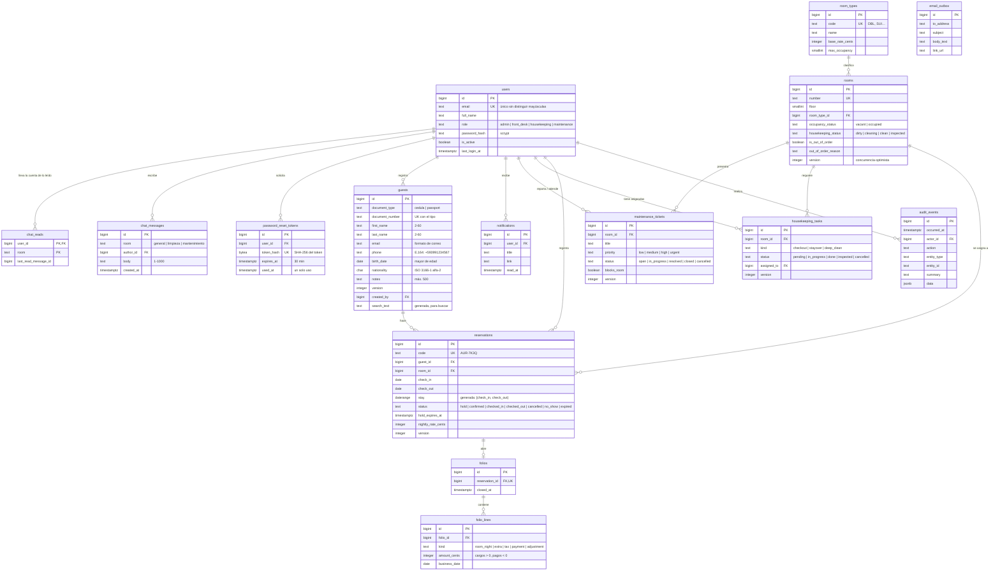

# Modelo de datos

Motor: **PostgreSQL ≥ 15** (ver [ADR-0002](adr/0002-postgresql-y-sql-explicito.md)).
Las migraciones viven en `migrations/` y se aplican en orden con `npm run db:migrate`.

## 1. Diagrama entidad-relación (modelo objetivo)

Las entidades marcadas como *implementadas* ya existen en las migraciones; el resto se crea en el
sprint indicado.



| Tabla | Estado | Sprint |
| --- | --- | --- |
| `users`, `user_sessions` | Implementada | 0 |
| `room_types`, `rooms` | Implementada | 0–1 |
| `audit_events` | Implementada | 1 |
| `guests` (entidad principal del CRUD) | Implementada | Bimestre 1 |
| `password_reset_tokens`, `email_outbox` | Implementada | Bimestre 1 |
| `chat_messages`, `chat_reads` | Implementada | Bimestre 1 |
| `hotel_settings`, `reservations` | Diseñada | 2 |
| `folios`, `folio_lines` | Diseñada | 3 |
| `housekeeping_tasks`, `maintenance_tickets`, `notifications` | Diseñada | 4 |

## 2. Convenciones

| Aspecto | Convención | Por qué |
| --- | --- | --- |
| Nombres | `snake_case`, tablas en plural, en inglés | Consistencia con SQL y con el código |
| Claves primarias | `bigint GENERATED ALWAYS AS IDENTITY` | Estándar SQL; evita insertar ids a mano |
| Fechas de estancia | `date` | Una noche no tiene hora; evita errores de zona horaria ([R11](../01-planificacion/riesgos.md)) |
| Instantes | `timestamptz` | Se guarda en UTC y se muestra en la zona del hotel |
| Dinero | `integer` en centavos | Sin errores de coma flotante (`0.1 + 0.2`) |
| Enumeraciones | `text` + `CHECK (... IN (...))` | Más fácil de evolucionar que `ENUM` |
| Concurrencia | Columna `version` en entidades editables | Detectar ediciones simultáneas ([ADR-0008](adr/0008-concurrencia-optimista.md)) |
| Auditoría | `created_at`, `updated_at` (trigger) y `audit_events` | Trazabilidad (RN-07) |

En Node, las columnas `date` se leen **como texto** (`'2026-11-03'`) y no como `Date` de JavaScript;
así una fecha nunca se corre un día por la zona horaria del servidor (ver `src/db/database.js`).

## 3. Reglas que protege la base de datos

La aplicación valida todo, pero las reglas críticas también viven en la base de datos: si un error
de programación se cuela, la base de datos lo rechaza.

### 3.1 Sin reservas solapadas (RN-02)

```sql
CREATE EXTENSION IF NOT EXISTS btree_gist;

ALTER TABLE reservations
  ADD COLUMN stay daterange GENERATED ALWAYS AS (daterange(check_in, check_out, '[)')) STORED,
  ADD CONSTRAINT reservations_no_overlap
    EXCLUDE USING gist (room_id WITH =, stay WITH &&)
    WHERE (status IN ('hold', 'confirmed', 'checked_in'));
```

Se lee: "no pueden existir dos filas activas con la misma habitación (`=`) cuyos rangos de estancia
se solapen (`&&`)". El rango es semiabierto `[llegada, salida)`, por eso una salida el día 5 y una
llegada el día 5 **no** chocan. Si dos peticiones intentan insertar a la vez, PostgreSQL deja pasar
una y la otra falla con el código `23P01` (`exclusion_violation`), que el servicio traduce a un 409.
Las retenciones (`hold`) bloquean igual que una reserva confirmada. Detalle en
[ADR-0007](adr/0007-overbooking-en-la-base-de-datos.md).

### 3.2 Otras restricciones

| Regla | Restricción |
| --- | --- |
| Correo único sin distinguir mayúsculas | `UNIQUE INDEX ON users (lower(email))` |
| Fuera de servicio exige motivo y fecha (y en servicio no tiene ninguno) | `rooms_out_of_order_consistency` |
| Una habitación ocupada no puede estar fuera de servicio (RN-10) | `CHECK (NOT (is_out_of_order AND occupancy_status = 'occupied'))` |
| Salida posterior a llegada | `CHECK (check_out > check_in)` |
| Un hold tiene vencimiento | `CHECK (status <> 'hold' OR hold_expires_at IS NOT NULL)` |
| Cargos positivos, pagos negativos, ajustes con cualquier signo | `CHECK (CASE kind WHEN 'payment' THEN amount_cents < 0 WHEN 'adjustment' THEN amount_cents <> 0 ELSE amount_cents > 0 END)` |
| Bitácora inmutable | Trigger que rechaza `UPDATE` y `DELETE` en `audit_events` |
| Un documento por huésped | `UNIQUE (document_type, document_number)` |
| Formato del documento según el tipo | `guests_document_format`: cédula `^[0-9]{10}$`, pasaporte `^[A-Z0-9]{5,20}$` |
| Teléfono en formato internacional | `CHECK (phone ~ '^\+[1-9][0-9]{6,14}$')` |
| Longitudes de nombres y notas | `CHECK (length(first_name) BETWEEN 2 AND 60)`, `CHECK (length(notes) <= 500)` |
| Mensaje del chat no vacío ni gigante, en una sala que existe | `CHECK (length(body) BETWEEN 1 AND 1000)`, `CHECK (room IN (...))` |
| El enlace de recuperación caduca después de crearse | `CHECK (expires_at > created_at)` |

## 4. Índices

| Índice | Consulta que acelera |
| --- | --- |
| `rooms (floor, number)` | Tablero agrupado por piso |
| `audit_events (occurred_at DESC)` | Feed de actividad reciente |
| `audit_events (entity_type, entity_id, occurred_at DESC)` | Historial de una habitación o reserva |
| `user_sessions (expire)` | Limpieza de sesiones vencidas |
| GiST de la restricción de exclusión | Búsqueda de solapes al reservar y al consultar disponibilidad |
| `reservations (status, hold_expires_at)` | Expirar holds vencidos |
| GIN trigram sobre `guests.search_text` | Búsqueda de huéspedes por fragmentos ("sala" → "Salazar") sin recorrer la tabla |
| `guests (last_name, first_name, id)` | Listado paginado en orden alfabético |
| `guests (nationality)` | Filtro por nacionalidad |
| `chat_messages (room, id DESC)` | Historial de una sala y conteo de mensajes sin leer |
| `password_reset_tokens (user_id) WHERE used_at IS NULL` | Anular los enlaces pendientes de una persona |

La mejora medida de cada índice está en [Rendimiento](../05-pruebas/rendimiento.md).

## 5. Migraciones

- Archivos `NNN_descripcion.sql` aplicados en orden; la tabla `schema_migrations` registra cuáles
  se aplicaron.
- Cada migración corre en su propia transacción; si falla, no queda a medias.
- El migrador toma un **bloqueo consultivo** (`pg_advisory_lock`) para que dos procesos no migren a
  la vez.
- **Nunca se edita una migración que ya está en `main`**: se agrega una nueva.
- `npm run db:seed` carga datos de demostración idempotentes (se puede ejecutar varias veces).

## 6. Diccionario de la entidad principal (`guests`)

La guía pide una entidad con al menos 5 atributos que permitan validar tipos, formatos y longitudes.
Cada regla se aplica en **tres** lugares: el navegador (para orientar), el servidor (la que manda) y
la base de datos (la última defensa).

| Atributo | Tipo | Regla | Navegador | Servidor (zod) | Base de datos |
| --- | --- | --- | --- | --- | --- |
| `document_type` | texto | `cedula` o `passport` | `<select required>` | `z.enum` | `CHECK IN (...)` |
| `document_number` | texto | Cédula: 10 dígitos, provincia 01–24 o 30, tercer dígito < 6 y **dígito verificador módulo 10**. Pasaporte: 5–20 letras o números. Se guarda sin espacios y en mayúsculas | `forms.js` con `isValidCedula()` | La misma `isValidCedula()` | `guests_document_format` + `UNIQUE` |
| `first_name`, `last_name` | texto | 2–60 caracteres; letras (con tildes y ñ), espacios, apóstrofo, punto o guion | `minlength`, `maxlength`, `pattern` | `min`, `max`, `regex` | `CHECK length` |
| `email` | texto | Formato de correo, máx. 254, se guarda en minúsculas | `type="email"` + `pattern` | `z.email()` | `CHECK ~ '…@…\.…'` |
| `phone` | texto | Se acepta `0991234567`, `(02) 234-5678` o `+57 300 123 4567`; se guarda en E.164 (`+593991234567`) | `normalizePhone()` | `normalizePhone()` | `CHECK ~ '^\+[1-9][0-9]{6,14}$'` |
| `birth_date` | fecha | Fecha real, no futura; el titular debe tener entre 18 y 120 años | `type="date"` con `min` y `max` | `isIsoDate()`, `ageOn()` | `CHECK > 1900-01-01` |
| `nationality` | `char(2)` | Código ISO 3166-1 alfa-2 de la lista de países | `<select>` | `z.enum(COUNTRY_CODES)` | `CHECK ~ '^[A-Z]{2}$'` |
| `notes` | texto opcional | Máximo 500 caracteres (se muestra escapado) | `maxlength` + contador | `max(500)` | `CHECK length <= 500` |
| `version` | entero | Aumenta en cada cambio; detecta ediciones simultáneas (409) | campo oculto | `versionSchema` | `CHECK > 0` |

Las funciones compartidas están en `src/public/js/lib/validators.js` (las importa el navegador y el
servidor) y sus pruebas en `test/unit/validators.test.js`.

