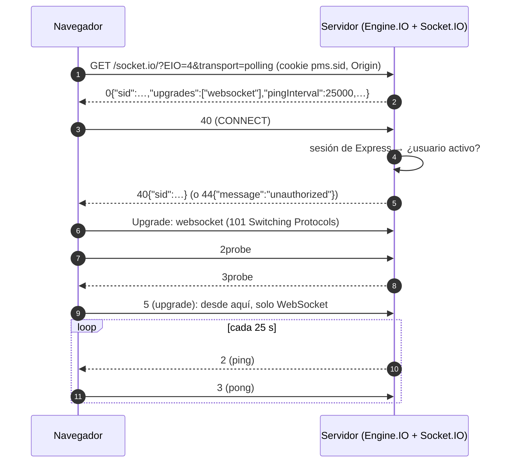
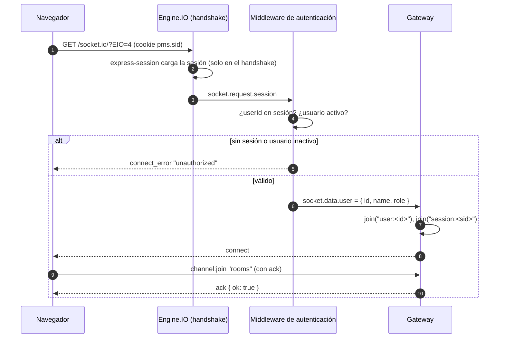

# Contrato de tiempo real (Socket.IO)

Este documento es el **contrato** entre el servidor y el JavaScript del navegador. Cualquier evento
nuevo se agrega aquí en el mismo PR que lo implementa.

## 1. Principios

1. **Comandos por HTTP, avisos por Socket.IO.** Los clientes no modifican datos emitiendo eventos;
   lo hacen con `fetch`/formularios. El socket solo anuncia hechos ya confirmados
   ([ADR-0005](adr/0005-comandos-http-eventos-websocket.md)). **Única excepción: el chat**, donde
   el mensaje viaja por el socket y el servidor lo valida, lo guarda y recién entonces lo difunde
   ([ADR-0011](adr/0011-chat-por-websocket.md)).
2. **Eventos delgados y versionados.** Un evento dice *qué* cambió y su nueva `version`; el cliente
   descarta lo que sea más viejo que lo que ya muestra.
3. **Canales con permisos.** El cliente pide unirse a un canal y el servidor decide si puede.
4. **Nada sensible en un broadcast.** Un evento no lleva datos que algún miembro del canal no deba ver.
5. **Siempre hay un camino de recuperación.** Si se perdieron eventos, la vista se resincroniza.

## 2. Cómo funciona Socket.IO sobre WebSocket

Socket.IO no es "WebSocket a secas": son dos capas. **Engine.IO** abre y mantiene la conexión (y
elige el transporte); **Socket.IO** agrega encima eventos con nombre, confirmaciones (*acks*), salas
y reconexión. Los paquetes de abajo se capturaron de esta aplicación con `curl`.

### 2.1 Handshake

1. **Apertura (Engine.IO).** El navegador pide `GET /socket.io/?EIO=4&transport=polling` con la
   cookie de sesión. Antes de aceptar, el servidor compara el `Origin` con el host (otro origen →
   `403`). Responde con el paquete `0` (*open*):

   ```text
   0{"sid":"0OIeuX4HyTRH4kOzAAAH","upgrades":["websocket"],"pingInterval":25000,"pingTimeout":20000,"maxPayload":16384}
   ```

   `maxPayload` es el límite de 16 KB que configuramos (`maxHttpBufferSize`).
2. **Conexión (Socket.IO).** El cliente envía `40` (*CONNECT* al espacio `/`). Aquí corre nuestro
   middleware de autenticación con la sesión de Express:
   - sesión válida → `40{"sid":"2LcJh8vhKUgiEzIEAAAM","pid":"csVV2RAxNXTo4RDWAAAN"}`
     (`pid` sirve para recuperar la conexión tras un corte);
   - sin sesión → `44{"message":"unauthorized"}` (*CONNECT_ERROR*) y el navegador vuelve al login.
3. **Mejora a WebSocket.** El cliente abre `ws://…/socket.io/?EIO=4&transport=websocket&sid=…`
   (respuesta `101 Switching Protocols`), comprueba el canal con `2probe` → `3probe`, envía `5`
   (*upgrade*) y desde ahí todo viaja por el WebSocket. En producción, con HTTPS, es `wss://`.



### 2.2 Eventos y confirmaciones

Un evento es un paquete Socket.IO `2` (*EVENT*) dentro de un mensaje Engine.IO `4`. Si el emisor
espera respuesta, el paquete lleva un número y la respuesta llega como `3` (*ACK*):

```text
421["chat:send",{"room":"general","body":"¿La 204 ya está lista?"}]     ← navegador (ack n.º 1)
431[{"ok":true,"message":{"id":42,"room":"general",…}}]                  ← servidor responde al ack 1
42["chat:message",{"id":42,"room":"general","body":"¿La 204 ya está lista?",…}]  ← difusión a la sala
42["presence:update",{"online":[{"id":2,"name":"Mateo Salazar",…}]},"Q7g19Si"]    ← con offset de recuperación
```

### 2.3 Mecanismos de respaldo

| Problema | Qué hace Socket.IO | Qué hace la aplicación |
| --- | --- | --- |
| Una red o proxy bloquea WebSocket | La conexión sigue por HTTP *long-polling* (empieza así y solo mejora si puede) | Nada: los eventos son los mismos |
| Se pierde la conexión | El cliente reintenta con espera exponencial (1 s, 2 s… hasta 5 s, con variación aleatoria) | Indicador "Reconectando…" en la barra superior |
| Corte breve (≤ 2 min) | `connectionStateRecovery` reenvía los paquetes perdidos y restaura las salas | — |
| Corte largo o reinicio del servidor | Conexión nueva (`socket.recovered === false`) | El tablero resincroniza `<main>`; el chat pide los mensajes con `afterId` |
| El servidor no responde a tiempo (`pingTimeout`) | Se considera desconectado y se reconecta | — |
| Sin JavaScript | No hay socket | Formularios HTTP normales; el chat se envía por `POST` |

## 3. Ciclo de vida de la conexión



- La sesión de Express se comparte con `io.engine.use()` aplicada solo al handshake, así no hay un
  segundo login ni tokens en la URL.
- Se verifica el encabezado `Origin` contra el host para impedir que otro sitio abra un socket con
  la cookie del usuario (*Cross-Site WebSocket Hijacking*); la cookie `SameSite=Lax` es la segunda capa.
- **Cerrar sesión** emite `session:ended` a la sala `session:<sid>` y desconecta esos sockets.

## 4. Canales

| Canal | Sala interna | Permiso requerido | Eventos que recibe |
| --- | --- | --- | --- |
| `rooms` | `channel:rooms` | `rooms.view` | `room:updated` |
| `activity` | `channel:activity` | `activity.view` | `activity:created` |
| `reservations` *(Sprint 2)* | `channel:reservations` | `reservations.view` | `reservation:changed`, `hold:created`, `hold:released` |
| `housekeeping` *(Sprint 4)* | `channel:housekeeping` | `housekeeping.view` | `task:changed` |
| `maintenance` *(Sprint 4)* | `channel:maintenance` | `maintenance.view` | `ticket:changed` |
| `dashboard` *(Sprint 5)* | `channel:dashboard` | `dashboard.kpis` | `kpis:changed` |

Salas automáticas (no se piden): `user:<id>` para notificaciones personales, `session:<sid>` para
cerrar sesión y `role:<rol>` para avisar a todo un rol (por ejemplo, a administración).

Salas del chat (`chat:<sala>`): el socket entra con `chat:join` si su rol tiene acceso. Un socket
mira una sola sala a la vez.

| Sala del chat | Roles con acceso |
| --- | --- |
| `general` | Todos |
| `limpieza` | Administración, Recepción, Limpieza |
| `mantenimiento` | Administración, Recepción, Mantenimiento |

## 5. Eventos cliente → servidor

| Evento | Argumentos | Respuesta (ack) | Descripción |
| --- | --- | --- | --- |
| `channel:join` | `channel: string` | `{ ok: true }` o `{ ok: false, error: 'forbidden' \| 'unknown_channel' }` | Unirse a un canal |
| `channel:leave` | `channel: string` | `{ ok: true }` | Salir de un canal |
| `chat:join` | `{ room, afterId? }` | `{ ok, room, messages, online }` | Entra a una sala del chat. Sin `afterId` trae los últimos 50 mensajes; con `afterId`, solo los posteriores (al reconectarse). Marca la sala como leída |
| `chat:send` | `{ room, body }` | `{ ok, message }` | Envía un mensaje (1 a 1000 caracteres, saneado). Errores: `VALIDATION_ERROR`, `CHAT_ROOM_FORBIDDEN`, `RATE_LIMITED` (más de 8 mensajes en 10 s) |
| `chat:history` | `{ room, beforeId }` | `{ ok, messages, hasOlder }` | Mensajes anteriores (de 50 en 50) |
| `chat:read` | `{ room, messageId }` | `{ ok }` | Marca como leído hasta ese mensaje |

Toda respuesta de error tiene la forma `{ ok: false, error: { code, message } }`, con el mensaje
en español listo para mostrar.

## 6. Eventos servidor → cliente

### `room:updated` (canal `rooms`)

```json
{
  "roomId": 12,
  "number": "204",
  "version": 8,
  "statusCode": "VD",
  "statusLabel": "Vacante sucia",
  "housekeepingStatus": "cleaning",
  "actor": { "id": 3, "name": "Lucía Andrade" },
  "occurredAt": "2026-10-22T21:15:03.120Z"
}
```

El cliente: si `version` es mayor que el `data-version` de la tarjeta, pide `GET /rooms/12/card` y
la reemplaza; actualiza contadores y anuncia el cambio en la región `aria-live`.

### `activity:created` (canal `activity`)

```json
{
  "id": 581,
  "occurredAt": "2026-10-22T21:15:03.120Z",
  "actorName": "Lucía Andrade",
  "summary": "Habitación 204: Sucia → En limpieza",
  "entityType": "room",
  "entityId": "12"
}
```

El cliente clona un `<template>` y llena los campos con `textContent` (nunca `innerHTML`).

### `chat:message` (sala `chat:<sala>`)

```json
{
  "id": 42,
  "room": "general",
  "body": "¿La 204 ya está lista?",
  "createdAt": "2026-11-17T14:44:02.511Z",
  "author": { "id": 2, "name": "Mateo Salazar", "role": "front_desk", "roleLabel": "Recepción" }
}
```

Se difunde **después** de guardarse. El cliente lo agrega una sola vez (también llega por el ack a
quien lo envió) y lo pinta con `textContent`.

### `chat:unread` (salas `role:<rol>` con acceso, menos quienes tienen la sala abierta y el autor)

```json
{ "room": "limpieza", "roomName": "Limpieza", "messageId": 43, "authorName": "Mateo Salazar", "preview": "Hay check-in a las 14:00" }
```

Notificación de mensaje nuevo: suma uno a la insignia del menú **Chat** y muestra un aviso.

### `presence:update` (todos los sockets)

```json
{ "online": [{ "id": 2, "name": "Mateo Salazar", "role": "front_desk", "roleLabel": "Recepción" }] }
```

Se emite cuando alguien se conecta o se va. Como cada clic en el menú cierra y abre el socket, la
salida se confirma tras 4 s sin conexiones; así la lista no parpadea al navegar.

### `notify` (sala `role:admin`)

```json
{ "tone": "info", "message": "Rosa Quishpe creó una cuenta de Recepción. Puedes cambiar su rol en Usuarios.", "href": "/users" }
```

### `session:changed` (sala `user:<id>`)

```json
{ "reason": "role_changed" }
```

Un administrador cambió el rol de esa persona: sus pestañas muestran un aviso y se recargan con el
menú y los permisos nuevos.

### `session:ended` (salas `session:<sid>` o `user:<id>`)

```json
{ "reason": "logout" }
```

Motivos: `logout`, `deactivated` (un administrador desactivó la cuenta) y `password_reset` (se
restableció la clave: se cierran todas las sesiones). El cliente muestra un aviso y redirige a
`/login`.

## 7. Orden, duplicados y reconexión

| Problema | Solución |
| --- | --- |
| Llegan dos actualizaciones desordenadas | Se compara `version`; se ignora la más vieja |
| El cliente que hizo la acción recibe su propio evento | Ya tiene esa versión (la respuesta HTTP la trajo); se ignora |
| Corte breve de red (≤ 2 min) | `connectionStateRecovery` de Socket.IO reenvía los eventos perdidos y restaura las salas |
| Corte largo o reinicio del servidor | `socket.recovered === false` → el cliente vuelve a unirse a sus canales y resincroniza `<main>` con `X-Partial: main` |
| El usuario cerró sesión en otra pestaña | `session:ended` → redirección a `/login` |

## 8. Convenciones de nombres

- **Eventos de dominio** (bus interno, servidor): `entidad.hecho_en_pasado` → `room.status_changed`.
- **Eventos de Socket.IO**: `entidad:hecho` → `room:updated`, `activity:created`.
- **Comandos del cliente**: `recurso:verbo` → `channel:join`, `chat:send`.
