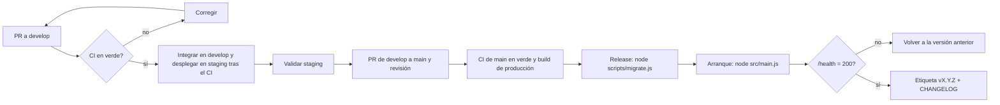

# Despliegue

## 1. Entornos

| Entorno | Para qué | Base de datos | Cómo se actualiza |
| --- | --- | --- | --- |
| Local | Desarrollo diario | Docker Compose (`pms_dev`) | `npm run dev` |
| Pruebas | Suite automatizada | `pms_test` (local) / servicio de PostgreSQL (CI) | `npm test`, GitHub Actions |
| Preproducción (staging) | Probar cambios integrados del equipo | Proyecto Neon `aurora-staging` | Servicio Render `aurora-pms-staging` desde `develop` |
| Producción (demo estable) | Presentar una versión validada | Proyecto Neon `aurora-prod` | Servicio Render `aurora-pms` desde `main` |

## 2. Primer despliegue en Render y Neon

Activa **staging primero**. Producción se habilita después de la primera promoción de la aplicación a `main`.

| Orden | Rama del Blueprint y del servicio | Blueprint Path en Render | Proyecto Neon Free |
| --- | --- | --- | --- |
| 1. Staging | `develop` | [render.develop.yaml](../../render.develop.yaml) | `aurora-staging` |
| 2. Producción | `main` | [render.yaml](../../render.yaml) | `aurora-prod` |

1. Integra la configuración en `develop`. GitHub Actions comprueba los PR dirigidos a ambas ramas y los pushes a cada una con Node 22 y 24. Cada trabajo usa su propia base temporal `pms_test`. [Workflow de CI](../../.github/workflows/ci.yml)
2. En Neon crea el proyecto **Free** del entorno con PostgreSQL 17. En **Connect**, selecciona su base y rol propietario, desactiva **Connection pooling** y copia la conexión directa con TLS. El migrador usa bloqueos de sesión y crea las extensiones `btree_gist` y `pg_trgm`. [Conexiones de Neon](https://neon.com/docs/connect/connection-pooling)
3. Con el CI de la rama en verde, en Render abre **New → Blueprint**, conecta GitHub y selecciona `a-sebs/PMS_PROJECT`. Introduce la rama y el **Blueprint Path** de la misma fila de la tabla. Pon la conexión Neon de ese entorno en `DATABASE_URL`. Revisa que se creará un solo **Web Service Free** y aplica. Cada servicio genera su propio `SESSION_SECRET` y recibe su propia URL HTTPS. [Blueprints de Render](https://render.com/docs/infrastructure-as-code)
4. Abre **Events** y **Logs** del servicio. El Dockerfile migra la base de ese entorno antes de iniciar Express. Comprueba su URL con la sección 5. Los cambios de código posteriores se publican cuando pasan los checks de la rama vinculada. [Integración con CI](https://render.com/docs/deploys)
5. Tras validar staging, abre el PR con **base `main` ← compare `develop`**. Integra la versión revisada y espera al CI de `main`. Repite los pasos 2 a 4 para producción con su propia fila de la tabla. En versiones posteriores basta repetir el PR de promoción y verificar la nueva versión. Los usuarios, sesiones y datos de staging permanecen en su proyecto Neon.

Para una demo con usuarios de varios roles y habitaciones, tras el primer arranque ejecuta una
vez el seed desde tu equipo. Usa una base de demo con datos ficticios. En Bash, este bloque pide
la conexión y una contraseña propia para las cuentas de demo, sin guardarlas en el historial.

```bash
(
  read -rsp 'Conexión directa de Neon: ' DATABASE_URL && echo
  read -rsp 'Contraseña nueva para las cuentas demo: ' SEED_PASSWORD && echo
  read -rp 'URL pública HTTPS de Render: ' APP_URL
  test -n "$DATABASE_URL" && test -n "$SEED_PASSWORD" && test -n "$APP_URL" || exit 1
  export DATABASE_URL SEED_PASSWORD APP_URL
  export SESSION_SECRET="$(openssl rand -hex 32)"
  NODE_ENV=production ALLOW_SEED_IN_PRODUCTION=true npm run db:seed
)
```

El seed requiere las dependencias instaladas (`npm ci`). Puedes probar el tablero con
`admin@aurora.test` y `limpieza@aurora.test`. La decisión y las alternativas se recogen en
[ADR-0013](../03-diseno/adr/0013-render-y-neon.md).

## 3. Variables de entorno en producción

| Variable | Valor |
| --- | --- |
| `NODE_ENV` | `production` |
| `DATABASE_URL` | La que entrega el proveedor |
| `SESSION_SECRET` | 32+ caracteres aleatorios, distinto del de desarrollo (la app no arranca con el valor de ejemplo) |
| `TRUST_PROXY` | `true` (el proveedor termina HTTPS en su proxy) |
| `APP_TIMEZONE` | Zona del hotel, por ejemplo `America/Guayaquil` |
| `LOG_LEVEL` | `info` |
| `PORT` | La que indique el proveedor |
| `APP_URL` | Render aporta la URL pública mediante `RENDER_EXTERNAL_URL`. Define `APP_URL` si usas dominio propio o despliegas en otro proveedor. Los enlaces de recuperación usan esta dirección. |
| `SHOW_MAIL_OUTBOX` | `false` (por defecto). Ponerla en `true` solo para una demo controlada: publica la bandeja de correos simulados en `/dev/correos`, con enlaces de recuperación |

### WebSocket seguro (`wss://`)

La guía exige conexión segura en el WebSocket. No hace falta configurar nada en el código: el
cliente de Socket.IO usa el mismo origen que la página, así que si la aplicación se sirve por
`https://`, el socket se abre con `wss://`. Requisitos: el proveedor debe aceptar WebSockets detrás
de su proxy HTTPS y `TRUST_PROXY=true`. Verificación: en las herramientas del navegador
(pestaña *Red* → *WS*), la conexión debe empezar con `wss://`.

## 4. Proceso de despliegue



- La imagen (`Dockerfile`) instala solo dependencias de producción y corre como usuario sin
  privilegios.
- Las migraciones son **solo hacia adelante**; una migración que falla deja la versión anterior
  funcionando (cada migración corre en su transacción).
- Si falla una versión publicada, vuelve al último despliegue sano desde **Events → Rollback**
  y corrige el código en GitHub. Volver a la imagen anterior conserva el esquema de Neon.
  [Rollback de Render](https://render.com/docs/rollbacks)

## 5. Verificación posterior al despliegue

1. `GET /health` → `{"status":"ok","database":"ok"}` y la versión esperada.
2. Iniciar sesión con dos usuarios en dos dispositivos y comprobar que el indicador diga "En vivo".
3. Cambiar el estado de una habitación y verlo en el otro dispositivo.
4. Enviar un mensaje en el chat y comprobar que la conexión del socket es `wss://`.
5. Revisar en los logs que no haya errores (`level >= 50`).
6. Tras un periodo de inactividad, medir cuánto tarda el primer acceso. Registrar el tiempo real,
   la URL, el SHA y el resultado del chat junto a la entrega. Tras verificar la versión, actualizar
   el changelog y etiquetar el commit desplegado según la versión entregada.

## 6. Respaldo y recuperación

- Respaldo antes de cada demo importante: `pg_dump --format=custom "$DATABASE_URL" > respaldo.dump`.
- Restauración: `pg_restore --clean --if-exists -d "$DATABASE_URL" respaldo.dump`.

## 7. Escalar (fuera del alcance del curso)

Ver [arquitectura § 10](../03-diseno/arquitectura.md#10-escalabilidad-más-allá-del-curso): adapter de
Socket.IO sobre PostgreSQL, sesiones ya compartidas en la base de datos, procesos programados en
una sola instancia.
