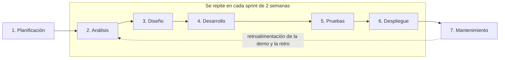

# Documentación del proyecto — Aurora PMS

> *Aurora PMS* es el nombre de trabajo del proyecto (se puede cambiar sin afectar nada técnico).

Esta carpeta es el **expediente del proyecto** a lo largo del ciclo de vida del software (SDLC).
Cada documento responde a una pregunta concreta y se versiona junto al código: si el código cambia
una decisión, el documento se actualiza en el mismo Pull Request.

## Modelo de ciclo de vida

Usamos un modelo **iterativo e incremental** (Scrum adaptado a 12 semanas). Las fases del SDLC no
ocurren una sola vez: la planificación y el diseño de alto nivel se hacen al inicio (Sprint 0), y en
cada sprint se repite un ciclo corto de análisis → diseño detallado → desarrollo → pruebas →
despliegue sobre un subconjunto del backlog.

## Índice por fase

| Fase | Documento | Pregunta que responde |
| --- | --- | --- |
| 1. Planificación | [Visión y alcance](01-planificacion/vision-y-alcance.md) | ¿Qué construimos, para quién y qué queda fuera? |
| 1. Planificación | [Plan del proyecto](01-planificacion/plan-del-proyecto.md) | ¿Cómo y cuándo lo construimos? |
| 1. Planificación | [Registro de riesgos](01-planificacion/riesgos.md) | ¿Qué puede salir mal y qué hacemos al respecto? |
| 2. Análisis | [Requisitos](02-analisis/requisitos.md) | ¿Qué debe hacer el sistema y con qué calidad? |
| 2. Análisis | [Glosario](02-analisis/glosario.md) | ¿Qué significa cada término del dominio hotelero? |
| 2. Análisis | [Matriz de cumplimiento de la guía](02-analisis/matriz-guia-docente.md) | ¿Dónde se cumple cada requisito de la guía del docente? |
| 3. Diseño | [Arquitectura](03-diseno/arquitectura.md) | ¿Cómo se organiza el sistema por dentro? |
| 3. Diseño | [Modelo de datos](03-diseno/modelo-de-datos.md) | ¿Qué datos guardamos y qué reglas protege la BD? |
| 3. Diseño | [Máquinas de estado](03-diseno/maquinas-de-estado.md) | ¿Qué cambios de estado son válidos y quién los hace? |
| 3. Diseño | [Tiempo real](03-diseno/tiempo-real.md) | ¿Qué eventos viajan por Socket.IO y a quién? |
| 3. Diseño | [Rutas HTTP](03-diseno/rutas.md) | ¿Qué URLs expone la aplicación? |
| 3. Diseño | [Seguridad](03-diseno/seguridad.md) | ¿Cómo protegemos datos y accesos? |
| 3. Diseño | [UI/UX y accesibilidad](03-diseno/ui-ux.md) | ¿Cómo se ve y cómo se usa? |
| 3. Diseño | [Contrato de UI](03-diseno/contrato-de-ui.md) | ¿Qué puedo cambiar de la interfaz sin romper el JavaScript, el servidor o las pruebas? |
| 3. Diseño | [Decisiones de arquitectura (ADR)](03-diseno/adr/README.md) | ¿Por qué elegimos lo que elegimos? |
| 4. Desarrollo | [Guía de desarrollo](04-desarrollo/guia-de-desarrollo.md) | ¿Cómo levanto el proyecto y cómo contribuyo? |
| 5. Pruebas | [Estrategia de pruebas](05-pruebas/estrategia-de-pruebas.md) | ¿Cómo sabemos que funciona? |
| 5. Pruebas | [Rendimiento](05-pruebas/rendimiento.md) | ¿Qué tan rápido es y qué mejoramos al medir? |
| 6. Despliegue | [Despliegue](06-despliegue/despliegue.md) | ¿Cómo llega a producción (demo)? |
| 7. Mantenimiento | [Mantenimiento](07-mantenimiento/mantenimiento.md) | ¿Cómo lo mantenemos vivo y sano? |

## Convenciones de esta documentación

- Idioma: español. Identificadores de código, tablas y eventos: inglés.
- Diagramas como código con [Mermaid](https://mermaid.js.org/) (GitHub los renderiza solo).
- Las decisiones importantes y difíciles de revertir se registran como ADR.
- Los requisitos tienen identificadores (`HU-07`, `RNF-03`, `RN-02`) para trazarlos hasta las pruebas.
